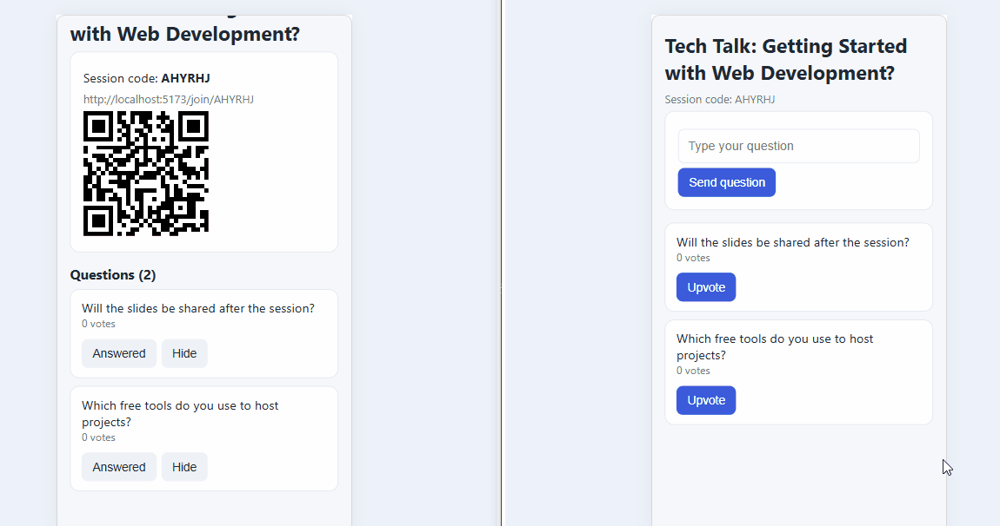

# Live Meeting Feedback Wall

A website where people in a meeting or seminar send questions from their phones and upvote the ones they care about. The host sees the ranked list update live and can mark questions as answered or hide them.

Live demo: https://live-meeting-feedback-wall.vercel.app

The backend runs on a free plan, so the first load after a quiet period can take up to a minute.

## Why I built this

The idea came from a tech event hosted by the Computer Club at my college, Kantipur Engineering College. When the host opened the floor for questions, I had a few things to ask but held back because the room was noisy and I was afraid of being judged. On the way home I kept thinking about it: what if anyone could ask a question or share feedback live, without having to speak up in front of a crowd? That became Live Meeting Feedback Wall.

## Features

- Host creates a session and gets a short join code, a link and a QR code
- Attendees join without signing up
- Questions appear on every screen instantly, with no refresh
- Upvoting with one vote per browser per question
- Questions are sorted by votes
- Host can mark a question as answered or hide it
- Host actions are protected by a secret key stored in the host's browser
- Questions are saved in the database and reload after a refresh

## Tech stack

| Part | Tools |
|---|---|
| Frontend | React, Vite, React Router, socket.io-client, qrcode.react |
| Backend | Node.js, Express, Socket.io |
| Database | MongoDB (Atlas), Mongoose |

## How it works

Loading a session uses normal REST requests. Everything that changes while people are watching uses Socket.io, with one room per session code.

| Event | Sent by | What it does |
|---|---|---|
| `join-session` | Any page | Puts the browser in the session's room |
| `question:new` | Attendee | Saves a question and broadcasts it |
| `question:upvote` | Attendee | Adds a vote if this browser hasn't voted yet |
| `question:status` | Host | Marks a question answered, hidden or visible (needs the host key) |
| `question:added` / `question:updated` | Server | Pushes changes to everyone in the room |

REST routes:

- `POST /api/sessions` creates a session and returns its code and host key
- `GET /api/sessions/:code` returns the session and its questions (the host key is never included)

## Demo



## Running it locally

You need Node.js and a MongoDB database (a free MongoDB Atlas cluster works).

```bash
git clone https://github.com/ManujaAdhikari/Live-meeting-feedback-wall.git
cd Live-meeting-feedback-wall
```

Backend:first copy `server/.env.example` to `server/.env` and add your MongoDB connection string.

```bash
cd server
npm install
npm run dev
```

Frontend, in a second terminal:first copy `client/.env.example` to `client/.env`

```bash
cd client
npm install
npm run dev
```

Open the address Vite prints (usually http://localhost:5173).


## Known limitations

- Vote limiting is per browser. Someone who clears their browser data or uses a private window can vote again. Stopping that would need accounts, which I left out on purpose to keep joining instant.
- The host key lives in one browser. If the host clears their data or switches device, they lose moderation access for that session.
- There is no automated test suite yet.
- CORS is restricted to the deployed frontend.
- Free hosting can put the backend to sleep and breifly drop live connections.

## Ideas for later

- Reactions bar and a presentation mode for projectors
- Option to end a session and export the questions as CSV
- Nepali language toggle

## Author

Manuja Adhikari